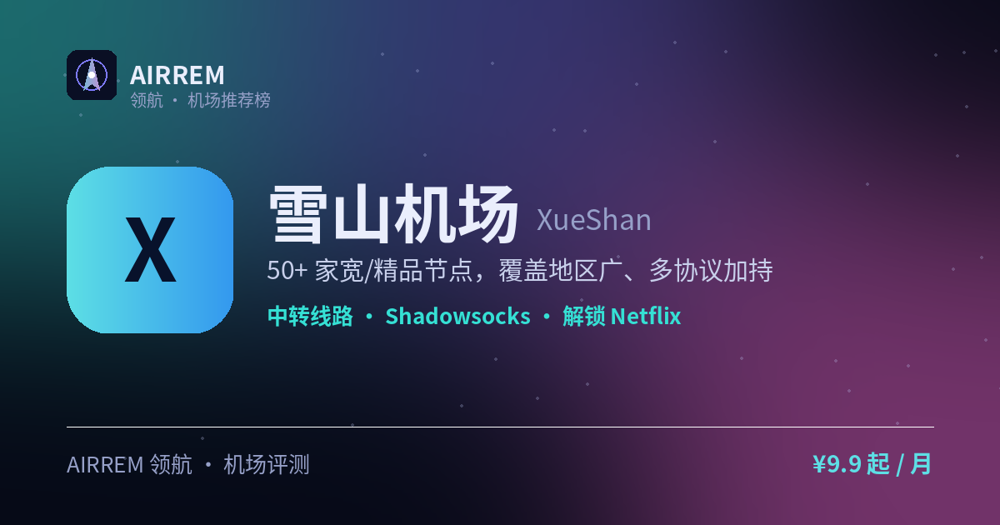

# 雪山机场评测 2026：日常全能，官网注册入口与套餐价格

> 一句话总结：50+ 家宽/精品节点，覆盖地区广、多协议加持

👉 **[雪山机场 官网注册入口](https://s.rtxk.us/s/vvdrepn)** ｜ [完整评测与横向对比](https://555736.xyz/xueshan/)

---

## 基本信息

| 项目 | 内容 |
| --- | --- |
| 机场名称 | 雪山机场 |
| 成立时间 | 2025 |
| 线路类型 | 家宽 / 中转线路 |
| 支持协议 | Shadowsocks / Trojan / Hysteria2 / VLESS |
| 流媒体解锁 | Netflix / Disney+ / ChatGPT |
| 节点地区 | 香港 · 台湾 · 韩国 · 日本 · 新加坡 · 美国 · 德国 · 法国 · 俄罗斯 等 |
| 计费方式 | 包月 / 包年 / 流量包 |
| 起步价格 | ¥9.9 / 月 |
| 推荐场景 | 想要节点广、性价比均衡的日常主力 |

## 雪山机场是什么

雪山机场是 2025 年下半年上线的机场，主打节点数量多、覆盖地区广，官方 Telegram 社群活跃，定位日常全能型选择。

## 线路 · 协议 · 解锁

号称 50+ 家宽/精品中转节点，覆盖港台韩日新美德法俄等地区，覆盖面偏广；支持 SS/Trojan/Hysteria2/VLESS，满足视频、开会、ChatGPT 等日常。

- 50+ 家宽/精品节点
- 覆盖港台日韩+欧美+俄罗斯
- 协议：SS/Trojan/Hy2/VLESS

> 💡 家宽/中转速度随运营商、时段波动，建议实测。

## 雪山机场 套餐价格

| 套餐 | 价格 | 说明 |
| --- | --- | --- |
| 中度月付 | ¥9.9 | 约 500GB/月 |
| 中度季付 | ¥19.9 | 约 500GB/月 |
| 不限流量包月 | ¥29.9 | 不限流量 / 月 |

> 套餐名称与流量可能调整，以官网为准。

## 优点与缺点

**✅ 优点**

- 节点多、覆盖地区广
- 多协议、客户端兼容好
- 官方社群活跃、公告及时

**⚠️ 缺点**

- 2025 年新站，长期稳定性待观察
- 机场行业存在跑路风险，建议先用月付或小额套餐验证稳定性，别一上来就大额年付。

## 适合谁 / 不适合谁

| 👍 适合 | 👎 不适合 |
| --- | --- |
| 要节点广、日常全能使用 | 只信运营多年老牌机场的用户 |
| 看重活跃社群的用户 |  |

## 我们的结论

2025 年上线，主打节点多、覆盖广，家宽/中转配合多协议，适合视频/会议/ChatGPT 日常；作为较新机场，建议先小额付费观察稳定性。

## 常见问题

**Q：雪山是老牌吗？**

A：不是，2025 年新站，建议先小额付费观察稳定性。

**Q：支持哪些协议？**

A：SS/Trojan/Hysteria2/VLESS，配置以官网教程为准。

## 同类机场推荐

拿不定主意？可以再看看这几家同类型的：

- **[守候](https://555736.xyz/shouhou/)** — 稳健老用户 / Emby 影音，¥15 起
- **[自由猫](https://555736.xyz/freecat/)** — 日常主力，¥6 起
- **[淘气兔](https://555736.xyz/taoqitu/)** — 联通移动用户，¥7.8 起

全部 38 家机场的横向对比与选购方法论：**[信号塔 SignalTower · 机场大全](https://555736.xyz/airports/)**

---

数据更新：2026-07 ｜ 价格、套餐与优惠码以官网实时为准 ｜ 本仓库为第三方评测整理，与 雪山机场 官方无隶属关系 ｜ 请遵守当地法律法规使用网络服务。

关键词：雪山机场、xueshan、家宽机场、多协议机场、机场推荐
